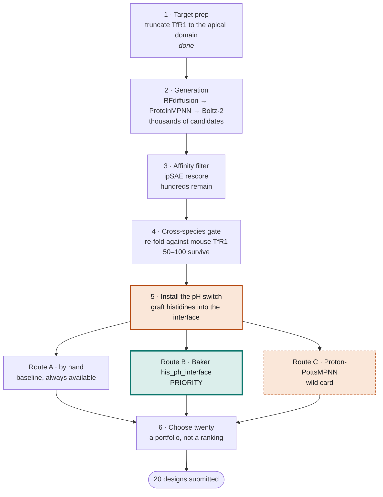

# TfR1 Binder Design

De novo design of a pH-switchable protein binder for human transferrin receptor 1, for the [Anthropic × Adaptyv 2026 competition, challenge 04](https://proteinbase.com/competitions/anthropic-adaptyv-2026/challenges/tfr1).

**Deadline:** Sunday 1 November 2026, 23:59 AoE.

---

## The challenge

Design a small protein, from scratch and entirely on a computer, that binds **TfR1** — a receptor on the surface of brain blood vessels whose day job is pulling iron into the cell. A laboratory then synthesises the top designs and measures whether they work.

Why anyone wants this: the brain is walled off from the bloodstream, and a typical therapeutic antibody reaches roughly a third of one per cent of its blood concentration in brain tissue. TfR1 already carries cargo across that barrier, so a binder that grabs it can smuggle a drug through. Several drugs on the market already work this way.

The binder has to satisfy three requirements at once.

| # | Requirement | Why it is there |
|---|---|---|
| ① | Bind human TfR1 at pH 7.4, K<sub>D</sub> under 1 µM | pH 7.4 is blood. This is the basic job. |
| ② | Also bind mouse TfR1 at pH 7.4 | Drugs are tested in mice before humans. A human-only binder cannot be tested at all. |
| ③ | **Release** human TfR1 at pH 6.0 | pH 6.0 means we are inside the cell. Letting go there frees the cargo to continue into the brain instead of being carried back out. |

Requirement ③ is the hard one. **Histidine** is a practical pH-switch residue because its usual side-chain pKa is near this range, but its environment changes its protonation and the effect on binding. Histidines are introduced into the **binder**, after a complex is designed; conserved TfR1 hotspots are a separate choice.

## The goal

Submit **twenty designs** that bind both species tightly, carrying a deliberate and documented spread of histidine placements.

That is the success criterion even if none of them switch, because it is the version of this experiment that produces an interpretable result either way. We are engineering requirements ① and ②, and making an informed bet on ③.

---

## Architecture

Six stages. Generation and filtering run on hosted endpoints; the pH switch and the final selection are done locally, by hand.



Every stage exists because of a specific biological fact:

| Stage | The biology that demands it |
|---|---|
| **1 · Target prep** | Focus on the apical domain while preserving transferrin access. Check biological assemblies, truncation edges and glycan exposure before choosing hotspots. |
| **2 · Generation** | Proteins bind by surfaces that fit. Make thousands of shapes and see which ones do. Binder length is capped at 65–90 residues so the interface stays breakable. |
| **3 · Affinity filter** | Requirement ① sets a floor of 1 µM. ipSAE scores the interface we designed rather than the target we already understood. |
| **4 · Cross-species gate** | Prioritize conserved surface patches, then evaluate the entire interface against mouse. Conservation alone does not establish cross-reactivity. |
| **5 · pH switch** | Histidine is the only residue that changes charge between pH 7.4 and 6.0, and burying a charge where no water reaches it breaks an interface. |
| **6 · Choose twenty** | Requirement ③ can only be scored approximately, so spread the bet rather than ranking on it. Includes 2 unmodified controls. |

### Stage 5 routes

The pH switch is the least certain part of the project, so it has three independent routes with a clear order of preference.

| Route | What it is | Standing |
|---|---|---|
| **A · By hand** | Rank positions by burial and adjacency, mutate, re-fold, repair breakages with ArcRefine | Baseline — zero install risk, happens regardless |
| **B · [`baker-laboratory/ph_binder_paper`](https://github.com/baker-laboratory/ph_binder_paper)** | Published, wet-lab-validated pipeline that places histidines **and scores pH sensitivity directly** | **Priority** |
| **C · [`christian-creator/ProtonPottsMPNN`](https://github.com/christian-creator/ProtonPottsMPNN)** | Inverse-folding model with protonation states in its alphabet | Wild card — never on the critical path |

Routes B and C are alternatives to *stage 5 only*. Both take the same input stage 4 already produces — a binder-on-target complex, binder as chain A, target as chain B — which is what makes them safe to attempt in parallel.

---

## Documents

| Document | What it covers |
|---|---|
| [The TfR1 Problem](docs/tfr1-biological-doc.html) | The biology from zero. Assumes no background. Start here if you are new. |
| [The TfR1 Pipeline](docs/tfr1-architecture.html) | The six stages in detail, with the biology behind each one. The working plan. |
| [Stage 1: target prep](docs/target-prep.md) | What the target-prep scripts do, every output file, how to run them, and how to visualize the result. |
| [Task 6: hotspot evidence](docs/task6-hotspot-analysis.md) | Research, provisional F237/K240/K241 patch, mouse mapping, limitations and generator handoff. |

Open the HTML files in a browser — they carry diagrams, an interactive pH simulator and clickable glossary terms.

## Visualize the receptor and hotspots

Requires Python 3 and PyMOL. Run from the repository root:

```sh
# Prepare inputs if you have not already done so:
python3 -I scripts/prep_target.py

# Render five annotated views and open the interactive PyMOL session:
python3 -I scripts/visualize_target.py --open
```

Five scenes, each captioned in the viewer: **01_overview** (the ectodomain dimer coloured by domain), **02_domains** (one chain, its three domains and the transferrin site at 619–670), **03_constraints** (the apical domain with the dimer seam, the glycans and everything else a binder must avoid), **04_target** (exactly what the generator receives), and **05_hotspots** (the candidate patches, best first). The patches are candidate attachment residues, not validated binding sites.

Results are saved in **`data/visualization/`**: one PNG per scene and **`tfr1.pse`**, the interactive session, which also carries named selections for each domain, the transferrin site, the glycans and each patch. Omit `--open` to render without launching the window. Reopen an existing result with:

```sh
pymol data/visualization/tfr1.pse
```

If PyMOL is not on your PATH, pass `--pymol /path/to/pymol`. The [target-prep guide](docs/target-prep.md) explains each view, the colour scheme, controls, limitations and troubleshooting.

## Contributing

The useful background is not biology but pipeline engineering, GPU orchestration and careful evaluation design. If you can run batch jobs on rented GPUs, reason about overfitting to a scoring function, or build the bookkeeping that tracks thousands of candidates down to twenty, you can contribute from day one.

Work is delegated only when it is off the critical path, has a defined input/output contract, and has a do-nothing fallback that is the plan we already have. Route B above is the clearest example.

## Task 6 handoff

Stage 1 now produces **provisional, structure-derived hotspot candidates**. Start with human **F237 / K240 / K241** (mouse **F239 / K242 / K243**). These are not a recovered list of the competition’s unnamed three conserved sites, and binding/pH sensitivity remain untested. See the [evidence and caveats](docs/task6-hotspot-analysis.md).

```sh
python3 -I scripts/prep_target.py
python3 -I -m unittest discover -s tests -v
pymol data/target/hotspots.pml
```

The generated `hotspots.json` preserves chain C and original human residue numbers for the existing target PDB. It also records crop-relative and mouse numbering. The old 21-residue avoid list was based on crystal packing; regenerated outputs use the biological assemblies. See [the target-prep guide](docs/target-prep.md) for the files, the filters and the caveats.
