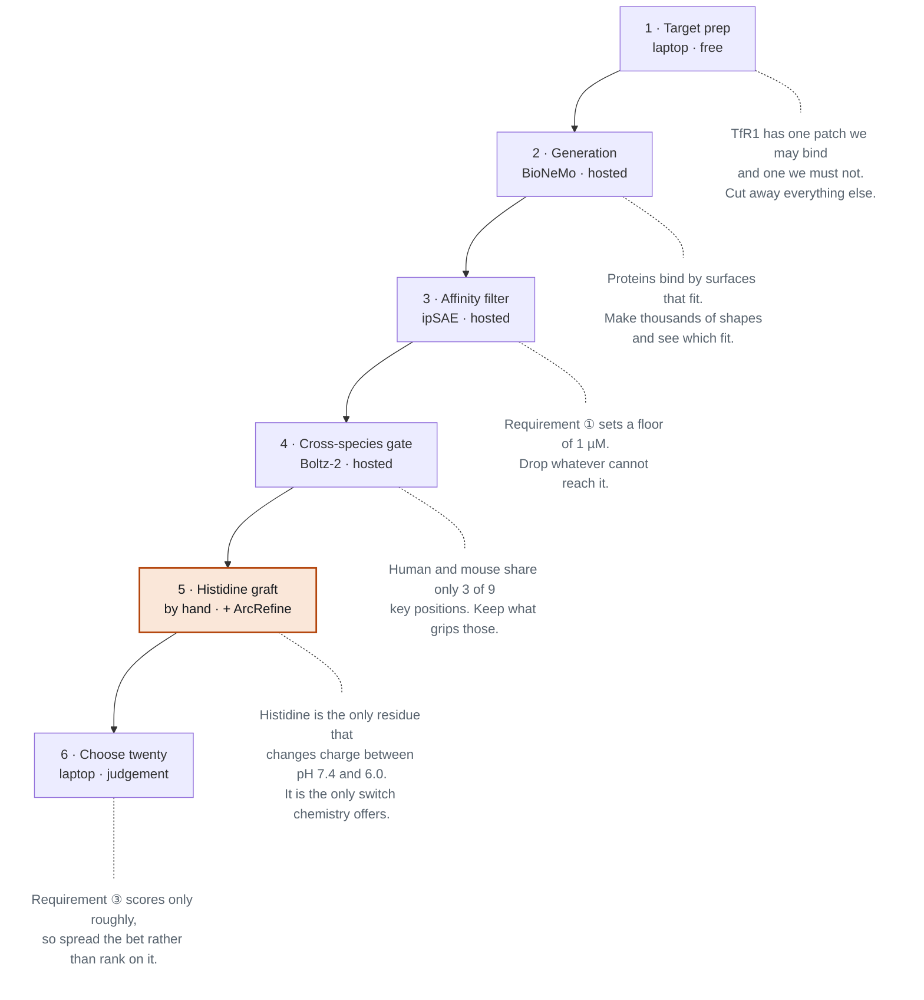
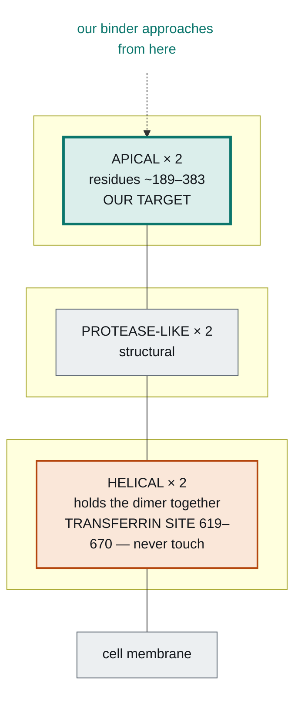
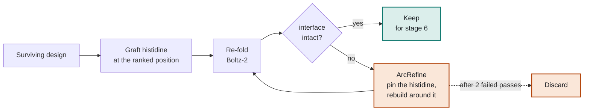

# The TfR1 Pipeline

**Working document — read this first.**

Six stages that turn a protein structure file into twenty submitted designs. Each one explains what to run, and why the biology leaves us no other sensible choice. Nothing here assumes you have read the other documents, or that you know any biology.

| | |
|---|---|
| **Written** | Sun 25 October 2026 |
| **Deadline** | Sun 1 November 2026 |
| **Background** | [The TfR1 Problem](tfr1-biological-doc.md), for the biology in full |

> This is the Markdown rendering of `tfr1-architecture.html`. The HTML version is the original and carries the full diagrams.

---

## 00 · What we are making

We are designing a small protein that grabs hold of a receptor on the surface of brain blood vessels, rides it into the cell, and then lets go because the inside is slightly more acidic than the outside.

Here is why anyone would want that. The brain is walled off from the bloodstream by vessels whose lining cells are welded together with no gaps between them, and almost nothing crosses. A typical therapeutic antibody reaches around a third of one per cent of its blood concentration in brain tissue. We have drugs that would treat Alzheimer's, Parkinson's and a family of inherited metabolic diseases, if only they could get in.

The way through is to use a door that already exists. A receptor called **TfR1** sits on those lining cells, where its day job is pulling iron into the cell. It grabs its cargo outside, the cell swallows it, and it releases inside. Attach a drug to something that binds TfR1 and the receptor will carry the whole package across for you. Several drugs on the market already work this way.

The competition asks for a binder that satisfies three requirements at once.

| # | Requirement | Why it is there |
|---|---|---|
| ① | Bind human TfR1 at pH 7.4, with KD under 1 µM | pH 7.4 is blood. This is the basic job. |
| ② | Also bind mouse TfR1 at pH 7.4 | Drugs are tested in mice before humans. A human-only binder cannot be tested at all. |
| ③ | Release human TfR1 at pH 6.0 | pH 6.0 means we are inside the cell. Letting go there is what frees the cargo to continue into the brain instead of being carried back out. |

Two pieces of vocabulary you will need throughout, and then we can start.

**KD** measures how tightly two proteins stick. It is a concentration: how much of one protein has to be floating around before half the copies of the other have caught hold of it. Counter-intuitively, **lower means tighter**. A nanomolar binder is strong, a micromolar binder is weak, and our floor of 1 µM is a modest bar to clear.

**pH** measures how many free protons are drifting in solution, on a scale where lower means more acidic. Blood sits at 7.4. The inside of the bubble a cell swallows things into sits at about 6.0. That difference is small, it is the entire basis of requirement ③, and stage 5 explains how a protein can be built to notice it.

---

## 01 · The pipeline at a glance

Six stages. Three of them generate and filter candidates, one installs the pH switch by hand, one chooses what to submit, and the first one costs nothing and determines whether any of the rest is aimed at the right thing.

> **The one sentence that explains the shape of all of it:** generate a large pool of binders that ignore pH entirely, then install the pH switch afterwards as a separate step. No model in the *generative* stack represents pH, so requirement ③ cannot come out of stage 2 and has to be added somewhere we control. Physics-based tools can estimate it once a structure exists, which is what stage 5 is built around.

---

## 02 · Stage 1 — Prepare the target

`Laptop` · `PyMOL` · `PDB 1CX8` · `UniProt Q62351`

Download the experimentally determined structure of human TfR1 from the Protein Data Bank, entry `1CX8`, and then throw most of it away.

### The biology behind it

TfR1 is two identical copies of the same protein locked together, anchored in the cell membrane. The part sticking out into the bloodstream folds into three distinct chunks, and only one of them is ours to touch.

The **helical** chunk sits at the bottom near the membrane, where it both holds the two copies together and provides the site where transferrin — the courier protein that carries iron through the blood — docks. Residues 619 to 670 form that site. **Block it and iron delivery stops throughout the body, which causes anaemia.**

The **apical** chunk sits at the top, pointing away from the cell, with no known natural partner and nothing above it. It is accessible, it is unoccupied, and it is as far from the iron site as it is possible to get. Several viruses independently evolved to enter human cells through it, and the brain-delivery drugs that reached the clinic bind there too.

Truncation is a cost decision and a safety decision at once. AlphaFold's runtime grows sharply with system size, and a site that is absent from the file cannot be bound by accident.

### What to do

1. **Cut to the apical domain**, roughly residues 189 to 383. Confirm the boundaries by eye in PyMOL rather than trusting the numbers, because a cut through the middle of a helix leaves a frayed, unphysical edge that the generator will happily design a binder against.
2. **Keep one chain.** TfR1 is a dimer, but one apical domain is the whole design surface. The second copy doubles the cost of every prediction downstream and buys nothing.
3. **Strip every heteroatom** — waters, sugars, ions. Leftover sugar chains are a classic way to silently poison a run, because the generator will design against them and they will not be there in the real experiment.
4. **Get the mouse sequence.** Mouse TfR1 is `Q62351` in UniProt. Align it to human, take the span matching the apical domain you just carved out, and save it as FASTA. No experimental mouse structure is needed, because mouse is only used for filtering and the structure predictor builds its own model from sequence.
5. **Write down the three conserved positions.** These become the hotspot residues handed to the generator in stage 2.

### Done when

- A single-chain PDB of roughly 195 residues, opened and visually inspected, with no heteroatoms left in it.
- A mouse apical sequence in FASTA, aligned and span-matched to the human one.
- Three hotspot residue numbers written down, in whatever format the generator expects.

---

## 03 · Stage 2 — Generate candidates

`Hosted` · `BioNeMo toolkit` · `RFdiffusion` · `ProteinMPNN` · `Boltz-2`

Run NVIDIA's `protein-binder-design` workflow against the apical domain file, with the three hotspots specified. It chains three models: one invents a backbone shape aimed at the hotspots, one chooses an amino acid sequence that will fold into that shape, and one predicts the resulting complex so it can be scored.

### The biology behind it

Proteins do their jobs by physically touching other molecules with surfaces that fit. There is no signal, no message, no action at a distance — two proteins stick together when their shapes are complementary and the chemistry across the contact surface is favourable. Designing a binder means designing a surface that matches a particular patch.

Nothing holds them together but many individually feeble attractions spread across that surface: slight charges pulling at one another, greasy patches huddling away from water, atoms sharing a hydrogen. Any one is negligible. A hundred of them across a well-matched surface is a firm grip.

### The one parameter worth arguing about

Set the binder length to roughly **65 to 90 residues** rather than accepting the default, and understand why, because this choice is made for the sake of stage 5 rather than stage 2.

> A large binder buries a lot of surface and spreads its binding energy thinly across hundreds of small contacts. An interface built that way is strong, and it *cannot be broken by one protonated histidine*, because no single disruption reaches enough of those contacts to matter.
>
> A short binder is forced to concentrate its grip into fewer contacts, which is exactly the single-point-of-failure property that requirement ③ depends on. We are deliberately trading a little stickiness for a breakable interface, because stickiness we can measure and the switch we cannot.

### Done when

- Thousands of candidate binders, each with a predicted structure of it sitting on the target.
- Spot-checked that designs are landing on the apical patch and nowhere near residues 619–670.

---

## 04 · Stages 3 and 4 — The two filters

`Hosted` · `ipSAE` · `Boltz-2`

Two cuts, applied cheapest first so that we never pay to evaluate a hopeless design twice.

### Filter one — affinity, scored with ipSAE

The default confidence score for a predicted complex is **ipTM**, and it fails us in a specific way here. It is computed across the whole system, so with a 195-residue target and a 75-residue binder, most of the number reflects how well the model understands the target — something we already knew and do not care about. The interface we actually designed barely moves it.

**ipSAE** rescores the same output focusing on contacts between the two chains. It separates designs far better, and the BioNeMo workflow already ranks on it, so this costs nothing to adopt.

> **The biology behind it.** Requirement ① sets a floor of KD under 1 µM, and among designs that pass everything else, the tightest binder wins. So this filter is about clearing a bar and then ranking, not about finding the single best design. Expect to keep roughly the top sixty per cent.

### Filter two — the cross-species gate

Re-predict every survivor against the *mouse* apical sequence instead of the human one, and keep only designs the model is confident about in both species.

> **The biology behind it.** Of the nine key positions on the apical patch, **human and mouse TfR1 have only three in common**. The two surfaces genuinely do not look alike, which is also why certain human-infecting viruses cannot infect mice at all.
>
> A binder that works in both species therefore has to take most of its grip from those three shared positions while tolerating the six that differ, either by avoiding them or by contacting them in a way that works with either residue. This is a real constraint on where on the patch we are allowed to bind, and it is why the plan generates far more designs than it needs.

### Expect heavy attrition

- This stage removes **half to three quarters** of the pool. That is not a failure of the stage; it is the reason we over-generate.
- A pool of 20 entering this gate leaves nothing to work with. A pool of several hundred leaves 50 to 100, which is what stage 5 needs.

---

## 05 · Stage 5 — Install the pH switch

`Laptop + GPU` · `FoldX` · `PROPKA3` · `Boltz-2` · `ArcRefine`

This is the stage the competition is won or lost in, it runs almost entirely on the laptop, and it is the only place where our own reasoning beats the tools.

### The biology behind it — read this part twice

Moving from pH 7.4 to pH 6.0 means roughly 25 times more free protons in solution. Almost nothing in a protein notices. Every amino acid side chain that can hold a proton is in exactly the same state at both conditions, because their tipping points all sit far outside that window.

Except one. **Histidine's tipping point sits at about pH 6.5, right between our two conditions.** At pH 7.4 roughly 11 per cent of histidine copies carry a positive charge; at pH 6.0, roughly 76 per cent do. It is the only residue in the entire alphabet that flips.

And here is why that matters. Water molecules cluster around charges and stabilise them, so **burying a charge where no water can reach it is energetically expensive.** A histidine sitting in the middle of a contact surface is tolerable while neutral, and becomes very costly the moment it turns positive. The surface comes apart on its own.

That is the whole mechanism. A histidine in the right place is a protein that can tell whether it is inside a cell, because the acidity tells it, and that responds by letting go.

| | At pH 7.4 — outside the cell | At pH 6.0 — inside the endosome |
|---|---|---|
| Histidine state | neutral | **positively charged** |
| Fraction charged | ~11% | ~76% |
| Effect at the interface | participates normally | buried charge, repels nearby Arg/Lys |
| Result | **binder holds on** | **binder releases** |

A histidine next to an arginine is the strongest placement available, because arginine stays positive at both pH values — so protonation does not merely delete a favourable contact, it creates an actively repulsive one.

### Three routes, in priority order

Until recently we assumed this stage had to be done entirely by hand, on the grounds that nothing in the toolchain represents pH. That is true of the generative stack — RFdiffusion, AlphaFold, ProteinMPNN and Boltz all see a histidine as just another residue type — but it is **not true of physics-based tools**. Rosetta has always been able to protonate a histidine explicitly, repack the structure, and report an energy in each state. Two published projects wrap exactly that capability for exactly our problem.

| Route | What it is | Standing |
|---|---|---|
| **A · By hand** | Rank positions by burial and adjacency, mutate, re-fold, repair breakages | Baseline. Always available, zero install risk, and what happens if nothing else lands. |
| **B · Baker `his_ph_interface`** | Published pipeline that places histidines *and scores the pH sensitivity directly* | **Priority. Do this if at all possible.** |
| **C · Proton-PottsMPNN** | Inverse-folding model with protonation states built into its alphabet | Wild card. Only with spare hands; never on the critical path. |

> Routes B and C are not alternatives to the pipeline. They are alternatives to *this stage only*, and both take the same input stage 4 already produces: a binder-on-target complex with the binder as chain A and the target as chain B. That clean boundary is what makes them safe to attempt in parallel.

---

### Route A — the hand-rolled baseline

`Baseline` · `Laptop` · `FoldX` · `PROPKA3` · `ArcRefine`

Described in full because it is the fallback, and because understanding it is how you will judge whether route B's automated choices are sensible.

#### Choosing where the histidine goes

You already have what you need, which is a predicted structure of each binder sitting on the target. Work down this filter:

1. **Find the interface.** List every binder residue with an atom within about 5 Å of any target atom. For a 75-residue binder that is typically 15 to 25 residues.
2. **Keep only the buried ones.** Compute solvent-accessible surface area for each, bound against free. A residue at the rim of the patch is still touching the target but remains half in solvent, and a charge there costs almost nothing because water can still surround it.
3. **Flag the ones beside a positive charge.** Of those, find any sitting within roughly 5 to 6 Å of an arginine or lysine on either side of the interface. Both stay positive at both pH values, so these are the prize positions.

> **Position beats count.** One histidine in the core beside an arginine is a switch. Three at the rim are three wasted mutations. Rank candidate positions by what they sit next to, never by how many you can fit.

#### Making the mutation

At the sequence level a graft is trivial: the binder has a tyrosine at position 34, you change that letter to H. Everything interesting is in choosing the letter and handling the consequences. Two routes, used for different jobs:

| Route | What it does | Used for |
|---|---|---|
| **In-place mutation** *FoldX BuildModel* | Deletes the old side chain, attaches a histidine to the same backbone, repacks the immediate neighbours. Seconds. | Producing structures to score. Convenient that FoldX both makes the mutant and scores it. |
| **Full re-fold** *Boltz-2* | Changes the letter in the sequence and predicts the whole complex from scratch. Slow. | The actual pass/fail gate. Asks whether the complex still forms at all. |

#### Why it breaks, and what to do about it

Breakage is the expected outcome, not the unlucky one, because we are deliberately damaging a structure the generator worked to optimise. Two reasons, both about packing. The residue being replaced was wedged against neighbours arranged around its specific geometry, and histidine is a flat ring on a short arm — swap out a bulky leucine and you leave a cavity, swap out a small alanine and the ring clashes. Separately, histidine is considerably more polar than the greasy residues that usually fill an interface core, so it costs desolvation energy even while neutral.

A variant has broken if the re-fold shows a sharp drop in interface confidence, a shifted pose measured against the parent, or the binder sitting somewhere other than the apical patch. That last case is dead regardless; the first two go to repair.

ArcRefine turns a discard into a repair. It carries the parent's binding pose forward and re-optimises the surrounding residues with the histidine held fixed, which re-solves the packing problem rather than undoing the graft.

> **The histidine must be pinned, and this is not optional.** ArcRefine optimises for binding, and a histidine in an interface core is a poor residue for binding — that is precisely why grafting one breaks things. Left unconstrained, the cheapest way for a sequence optimiser to repair the interface is to mutate the histidine back into something that packs well, and it will report a much improved binder that no longer does the one thing we needed.
>
> Check first whether ArcRefine supports fixed positions. If it does not, abandon it rather than working around it.

A related and subtler caution: refinement that genuinely improves affinity pushes a design toward the heavily buried interfaces that one charge cannot break, undoing the argument for short binders in stage 2. Treat refinement as repair rather than improvement, run the fewest passes that restore a foldable interface, and treat a repaired variant that comes back markedly tighter than its parent as a warning sign rather than a success.

#### Scoring, and what the scores are worth

Two free CPU tools rank the survivors. **PROPKA3** predicts the tipping point of each ionisable residue from a structure, and the useful quantity is the shift between the bound complex and the free binder: a histidine whose tipping point is pushed down by burial is a loaded spring, wanting a proton and unable to have one while bound. **FoldX** reports binding energy at a specified pH, so take the difference between its answers at 7.4 and 6.0 and rank by that gap.

Be honest about what these numbers are. Neither tool was built for designed interfaces and published accuracy on them is poor. Use them to rank-order candidates that are already structurally sound, and never to rescue a design that failed an earlier stage.

**What route A cannot tell you:**

- A variant that **breaks while neutral** — measurable, the re-fold shows it.
- A variant that is **tolerated while neutral and fatal when charged** — this is what we want, and route A cannot see it.
- A variant that is **tolerated while neutral and harmless when charged** — a wasted mutation, and route A cannot see this either.

Those last two look identical to every model in route A, because none of them represent charge state. What separates them is geometric reasoning done by hand: is this histidine buried deeply enough that a charge cannot be solvated, and is there a positive charge close enough to push against it? **Closing that gap is the entire reason route B exists.**

---

### Route B — the Baker pH interface pipeline

**PRIORITY** · `CPU` · `PyRosetta` · `ProteinMPNN` · `AF2 / Boltz-2`

> **[`baker-laboratory/ph_binder_paper`](https://github.com/baker-laboratory/ph_binder_paper)** — MIT · published, wet-lab validated

A pipeline from the group that built most of the tools we already use, written for precisely this problem: turning an existing binder into a pH-dependent one by placing histidines. It supersedes route A rather than supplementing it.

The repository holds two separate pipelines and **we want the second one.** The *exploder* pipeline destabilises the binder's own fold at low pH so the whole protein comes apart, which would work but is not our mechanism. The *interface* pipeline places histidines so they hydrogen-bond the target at high pH and lose that bond while gaining charge at low pH. That is requirement ③ restated in their vocabulary.

#### Three steps

1. `his_ph_interface_design.py` finds binder positions that could take a histidine accepting a hydrogen bond from the target, scores each by whether the partner is backbone or side chain and whether the position is core or surface, then draws weighted sets of positions, places histidines, redesigns the rest of the binder with ProteinMPNN, and assigns each set a pH score.
2. Run the designs through an oracle — AF2, or Boltz-2 in our case — and drop anything whose interface moved.
3. `his_ph_interface_hbonds.py` re-scores the predicted structures by protonating and deprotonating every histidine, repacking each state, and reporting what changed.

#### The column that matters

Step 3 reports `ddg_soft_lowph_vs_high`, and **a positive value means binding is weaker at low pH**. That is a direct numeric readout of the thing route A has to guess at. It also gives `ph_score`, counts of cross-interface histidine hydrogen bonds at each pH, and net charge in both states.

There is also `his_ph_interface_distances.py`, a standalone screen reporting each binder histidine's closest approach to arginine, lysine, aspartate and glutamate on the target. That is route A's position-ranking step, already written.

> **It independently confirms our placement logic.** Their README notes that the original hypothesis was histidine pairs hydrogen-bonding each other, and that it was later found the **positive-to-positive charge effect is probably the stronger force** — which is exactly the reasoning route A uses when ranking positions by proximity to an arginine or lysine. They arrived at it by running the experiments.

#### What it costs

PyRosetta is the real obstacle. It is not on pip, it needs a licence (free for non-commercial use), and it wants Python 3.12 alongside npose, numba and scipy. ProteinMPNN arrives as a git submodule, so clone with `--recursive`. The scripts are also slow, running multiple rounds of ProteinMPNN sampling and Rosetta repacking per input.

The input format is exactly what stage 4 hands us — the complex with binder as chain A and target as chain B — and the binder does not need to contain any histidine beforehand.

---

### Route C — Proton-PottsMPNN

**WILD CARD** · `GPU` · `uv · Python 3.12` · `HBPLUS` · `RF3 or Boltz-2`

> **[`christian-creator/ProtonPottsMPNN`](https://github.com/christian-creator/ProtonPottsMPNN)** — MIT · 2026 preprint, research code

The most elegant of the three and the least certain. It extends PottsMPNN, an inverse-folding model that learns a Potts energy function, by adding **protonation states as first-class tokens in the amino acid alphabet**. Histidine becomes either `HIS-P` when charged or `HIS-S` when neutral, and acids get their own pair. Because one energy function can then score alternative protonation assignments on a fixed backbone, the design engine can pin a protonated centre and redesign its neighbourhood so that binding switches with pH.

Put differently, pH-awareness lives *inside* the model rather than being bolted on afterwards. If it works it beats route B, and that is the only reason it stays on the list.

#### How it would be used

The engine places protonated centres and runs block descent over the neighbourhood, optimising a weighted blend of overall stability against a selectivity gap — the energy difference between protonated and deprotonated states. Sweeping that weight from pure stability to pure selectivity produces a Pareto front to pick designs off. Every design is written out with its protonation states attached alongside its plain sequence.

#### Why it is the wild card and not the priority

- The folding step uses RF3, whose weights are roughly 3 GB and **do not ship with the repository**. You would need a separate checkpoint and a GPU, or take the manifest it exports and fold with Boltz-2 instead.
- HBPLUS is an external C binary that cannot be pip-installed, needed by the labeller and the fold scoring though not by the design engine itself.
- It is research code accompanying a 2026 preprint, and the README is candid that the RF3 path was exercised with an internal checkpoint.
- Its protonation labeller reports average precision of 0.70 on histidine, which is usable, against 0.33 on acids, which is not. Histidine is the one we care about, but the gap is worth knowing.
- It is a second heavy environment on top of PyRosetta, with a `uv` install pinned to Python 3.12.

**Conditions for attempting it:**

- Only if someone other than the project owner has the time, and only once route B is standing.
- Nothing in the submission plan may depend on it. If it produces something that is upside; if it produces nothing, nobody notices.
- Realistically this is version-two material rather than something that lands inside eight days.

---

### Which route runs, and who runs it

Route A is yours and happens regardless, because it needs nothing installed and you already know how to do it. Route B is a well-bounded package someone else can build, with a defined input, a defined output, published documentation and no dependency on anything else in the pipeline. Route C only exists if there is a spare person who wants it.

The sequencing that matters is that **stage 4 output does not exist until Wednesday**. Anyone building route B should spend the first days installing PyRosetta and running the interface pipeline against any public binder-target complex, so the environment is proven before our designs arrive. Handing someone an install problem and a scientific problem at the same moment is how both of them slip.

---

## 06 · Stage 6 — Choose twenty

`Laptop` · `Foldseek` · `PyMOL`

Treat this as portfolio construction rather than taking the top twenty rows of a spreadsheet.

> **The biology behind it.** Only twenty designs get synthesised and measured, with no second round. Requirement ③ can now be scored approximately — route B in stage 5 gives a real number for it — but approximately is not reliably, so a submission ranked purely on predicted affinity and a noisy pH score would fail uniformly and teach us nothing about why. A deliberate spread fails partially and tells us which direction to move.
>
> Twenty near-copies of one design is one experiment. Twenty distinct designs is twenty.

| Slots | Design class | What it tests |
|---|---|---|
| 6 | Highest affinity, one well-placed histidine | The conservative bet — minimum perturbation to a strong interface. |
| 8 | Mid affinity, two histidines at distinct sites | The central hypothesis. Two shots at a switch without over-committing. |
| 4 | Aggressive, three histidines | Covers the case where one protonation is simply not enough force. |
| 2 | Unmodified parents, no histidine added | Internal control. Separates "the binder was bad" from "the histidine broke it". |

Those last two slots feel like wasted submissions and are not. Without them a uniformly negative result is uninterpretable, and an uninterpretable result is the one outcome worth actually fearing.

### Three checks before submitting

- **Diversity.** No pair above roughly 60 per cent sequence identity, and no two submissions using the same fold against the same patch.
- **Novelty.** Run Foldseek against the whole PDB. The rules require designs to be de novo rather than modified versions of existing binders, and we want that evidence collected calmly on Saturday rather than scrambled at the deadline.
- **Eyes.** Open all twenty in PyMOL. Twenty structures is twenty minutes and it catches what no metric reports — a binder threaded through a loop, an interface made entirely of backbone, a histidine pointing into solvent where it can do nothing.

### Done when

- A CSV ranked by preference, with at least `name`, `sequence` and `molecule_class`.
- Every sequence between 10 and 250 residues, with the C-terminal tag kept clear of the binding surface.
- Foldseek output saved as evidence of de novo origin.

---

## 07 · Constraints and calendar

One mid-range GPU, around two hundred dollars, evenings plus next Saturday, and twenty submission slots. The constraints did most of the design work above.

| Day | You | The machine, overnight |
|---|---|---|
| **Sun 25** *(today)* | Probe the BioNeMo workflow on NVIDIA's own example, twice: once for function, once for throughput. All of stage 1. Install BindCraft tonight as a fallback regardless. | First generation run |
| **Mon 26** | Inspect the pool. Confirm designs land on the apical patch and nowhere near 619–670. | Generation continues |
| **Tue 27** | Affinity filter. Read the ipSAE distribution rather than trusting the top of the list. | Cross-species gate |
| **Wed 28** | Survey survivors. Decide whether a second, aimed generation run is worth it. | Second run, if called |
| **Thu 29** | Lock the pool. Begin the histidine position ranking on paper. | Re-fold first variants |
| **Fri 30** | Histidine scan, PROPKA and FoldX. ArcRefine, two hours, hard stop. | Re-fold variants and repairs |
| **Sat 31** | Portfolio selection, Foldseek, PyMOL inspection. | — |
| **Sun 1** | Assemble the CSV, write the methods note, submit. | — |

### What will eat the week

- **Environment setup.** Versions of CUDA, drivers and model libraries disagreeing. Budget hard caps on every install and smoke-test on a tool's own bundled example before pointing it at TfR1.
- **Bad target prep.** Wrong chain, leftover sugars, a boundary slicing through a helix. It silently poisons everything downstream and costs ten minutes to prevent by opening the file and looking at it.
- **Tool creep.** The urge to add a fourth tool on Wednesday because a paper looked good. Resist this hardest; the plan is already at the edge of what the time supports.
- **Idle GPU.** An instance left running over a workday is about twenty dollars, which is ten per cent of the budget spent on nothing. Stop it whenever you close the laptop.

> **The honest caveat, stated plainly for anyone joining.** The pH switch remains the least certain part of this project. Route B gives us a physics-based estimate rather than nothing, which is a real improvement over designing blind, but Rosetta's pH energies on designed interfaces are noisy and no part of this has been validated on our target. We are engineering requirements ① and ②, and making an informed bet on requirement ③ rather than a blind one.
>
> That sets what counts as success. Twenty designs that bind both species tightly, carrying a deliberate and documented spread of histidine placements, is a good submission even if none of them switch — because it is the version of this experiment that produces an interpretable result either way.

---

**Where to start.** Stage 1 is free, needs no GPU, blocks everything else, and is the highest-leverage evening in the project. Download 1CX8, cut it to the apical domain, strip it, look at it in PyMOL, and align the mouse span. Do that first.

**If you can help.** The useful background is not biology but pipeline engineering, GPU orchestration and careful evaluation design. If you can run batch jobs on rented GPUs, reason about overfitting to a scoring function, or build the bookkeeping that tracks thousands of candidates down to twenty, you can contribute from day one.

*Residue ranges follow the structure literature and should be re-checked against 1CX8 itself. Tool capabilities are as described on their own pages and have not been independently verified. ArcRefine's reported results are n = 10 per arm from a single author. GPU pricing is indicative.*
