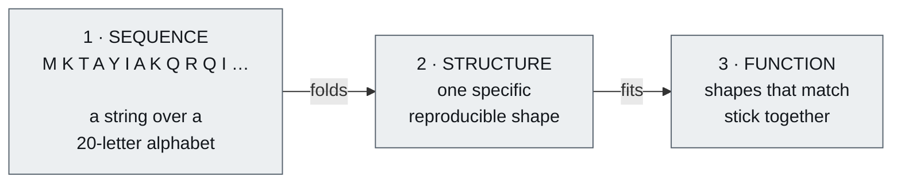
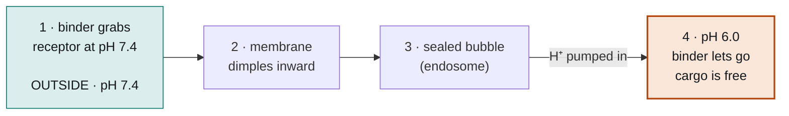
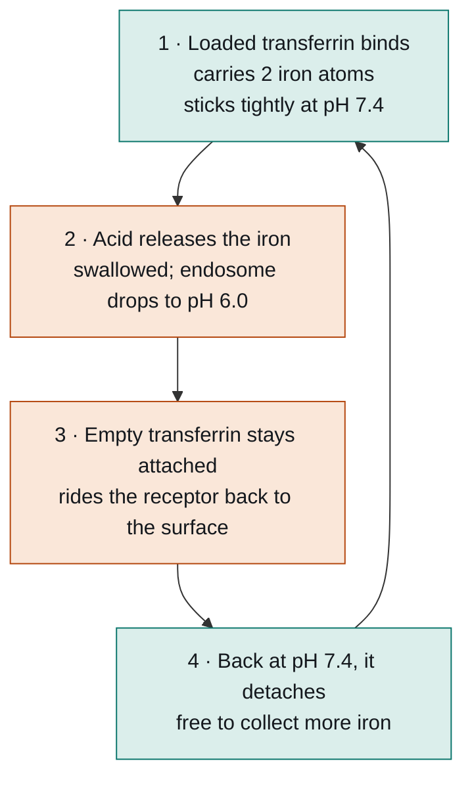
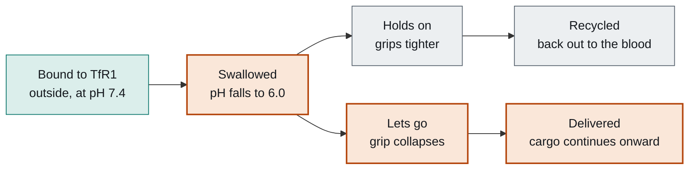
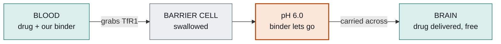
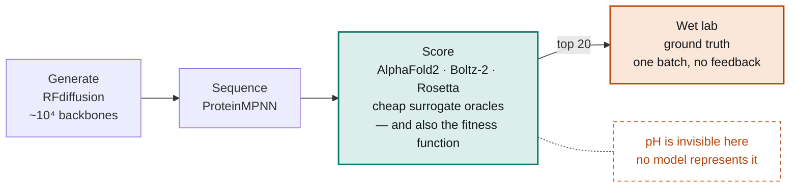

# The TfR1 Problem

**Project primer — biology from zero.**

We are designing a protein that grabs hold of a receptor on the surface of brain blood vessels, rides it into the cell, and then lets go again because the inside is slightly more acidic than the outside. This page explains every piece of that sentence from the beginning, assuming you know no biology at all.

| | |
|---|---|
| **Audience** | Engineers and programmers, no bio background |
| **Reading time** | ~25 minutes |
| **Deadline** | 1 November 2026 |

> This is the Markdown rendering of `tfr1-biological-doc.html`. The HTML version is the original and carries the diagrams, an interactive pH simulator and clickable glossary terms.

---

## 00 · The whole problem on one screen

We have entered a competition whose task is to design a small protein, from scratch and entirely on a computer, that manages to do three separate things at the same time. Once submissions close, a laboratory will synthesise the designs that scored best and measure whether they actually work.

| # | Requirement | In plain terms |
|---|---|---|
| 1 | Bind human TfR1 at pH 7.4 | Stick to a specific human protein, under the conditions found in blood |
| 2 | Bind mouse TfR1 at pH 7.4 | Also stick to the mouse version of that protein, so the drug can be tested in mice |
| 3 | Release human TfR1 at pH 6.0 | Let go the moment the acidity rises slightly |

The third requirement is the interesting one, and although it looks arbitrary at first, it is anything but. A slight rise in acidity is the signal by which a molecule can tell that it has been swallowed by a cell, so what we are really asking our protein to do is notice that it has moved indoors and respond by letting go of whatever it was holding.

### The same thing, stated precisely

That table is the brief as the competition writes it. Stated in the language of the problem, which parts 01 to 10 below will build up from nothing, the specification reads like this.

- **Bind the apical domain, and leave the transferrin site alone.** TfR1 has a patch at the top with no natural partner, which is where we aim. Residues 619–670 form the site where the iron courier binds, and blocking that would stop iron delivery throughout the body and cause anaemia.
- **Grip the three positions that human and mouse share.** Of the nine key positions on the apical patch, human and mouse TfR1 have only three in common. A binder that works in both species has to take most of its grip from those three while tolerating the six that differ, either by avoiding them or by contacting them in a way that works either way.
- **Put histidines at the centre of the contact surface.** Histidine is the only amino acid whose tipping point, around pKa 6.5, falls between pH 7.4 and pH 6.0, which makes it the only residue that changes its charge between the two conditions. Where it sits matters more than how many there are, and one placed beside an already-positive side chain hits hardest, because protonating it creates direct repulsion.
- **Clear 1 µM, then go as low as you can.** K<sub>D</sub> below 1 µM is the floor for qualifying. Among the designs that survive the pH test, the tightest binder wins, so the threshold is something to clear rather than something to aim at.
- **Design it from scratch.** The rules require the binder to be de novo, so taking an existing anti-TfR1 antibody and modifying it is disqualifying. We check our designs against known structures to prove originality.

### Why this is hard

The first requirement and the third pull in opposite directions. The strongest protein contact surfaces are large, greasy and deeply buried, with their binding energy spread thinly across hundreds of small contributions, and a surface built that way cannot be broken by one extra charge no matter where you put it. What we need instead is a surface that is strong at pH 7.4 and yet has a single point of failure, with a histidine sitting exactly on it.

| Too weak | What we want | Too well buried |
|---|---|---|
| never binds at all | holds at 7.4, breaks at 6.0 | one charge cannot break it |
| fails ① — no measurable K<sub>D</sub> | **all three satisfied** | fails ③ — binds at both pH values |

The viable designs sit in a narrow band. That axis is a simplification, because what really matters is not raw strength but whether the binding energy is concentrated enough to have a single point of failure. A thinly spread interface can be weak and still unbreakable.

Requirement 2 then narrows things further by restricting where on the patch we may bind at all, so the designs we are hunting for sit in the intersection of all three constraints.

The hardest part is not biological. None of the tools we design with, meaning RFdiffusion, AlphaFold, ProteinMPNN and the rest, represent pH or charge state at all, so the one requirement that defines this challenge is invisible to every model in the pipeline. The histidine placement has to be reasoned out by hand and tested blind, on the only twenty designs we are allowed to submit.

### How to read the rest

Nothing below assumes any prior biology, and each part uses only terms that have already been defined in the parts before it. Every term is collected in the [glossary](#10--glossary) at the end. If a sentence in this summary did not mean anything to you, that is expected, and the part that explains it is listed in the contents.

---

## 01 · What a protein is

A **protein** is a chain, built by linking small molecules called **amino acids** end to end like beads on a string. Because there are 20 standard kinds of amino acid to choose from, a protein is quite literally a string over a 20-letter alphabet.

Every amino acid is built from an identical backbone section, which does the linking, together with a **side chain** that sticks out sideways and is what distinguishes the 20 types from one another. If the backbone is the chassis, then the side chains are the payload, because essentially all of the chemistry that matters happens there.

Once the chain exists it does not stay floppy for long, since it folds spontaneously and reproducibly into one specific three-dimensional shape that is determined entirely by its sequence. Give it the same sequence and it will arrive at the same shape every time.

> **If you think in code.** The sequence is source code, the folded 3D structure is the compiled binary, and the function is runtime behaviour. Folding is the compiler that turns one into the other, and AlphaFold is a model that learned to emulate that compiler.



**The central chain of reasoning.** Sequence determines shape; shape determines function. Proteins do their jobs by physically touching other molecules with surfaces that fit. That is the mechanism behind nearly all of biology.

### Two levels of structure above the bare chain

Folding does not happen all at once from chain to finished shape. There is an intermediate level worth knowing about, because the names of things later on depend on it. As a chain folds, stretches of it settle into one of two recurring local shapes: a spiral coil called an **alpha-helix**, or a flat zigzag ribbon that lines up alongside its neighbours to form a **beta-sheet**. Almost every protein is built from some arrangement of corkscrews and ribbons connected by looser loops.

Those local shapes then pack together into **domains**. A domain is a compact chunk of chain, usually somewhere between 100 and 200 residues, that folds up as its own semi-independent unit and holds its shape whether or not the rest of the protein is there. A domain is a module in all but name, and large proteins are generally three or four of them strung together, each doing a different job.

One more word you will need constantly: a **residue** is one amino acid sitting at one numbered position in the chain, so when the competition describes the transferrin site as "residues 619–670" it simply means positions 619 through 670.

---

## 02 · How two proteins stick together

When two proteins bind to one another, no permanent chemical bond forms between them. Instead they are held together by a large number of individually feeble attractions spread across their contact surfaces: slight charges pulling at one another, greasy patches huddling together away from water, and atoms sharing a hydrogen between them. Any single one of these is weak enough to ignore, but a hundred of them across a well-matched surface add up to a firm grip.

Velcro is a better mental image here than the usual lock and key, because it captures both the way many small hooks share the load without any one of them being essential, and the way the overall strength depends on how well the two surfaces match across their whole area.

> This has a consequence that matters enormously later on: **binding is reversible and statistical rather than permanent.** At any given instant some copies of the two proteins are stuck together while others are floating free, and they swap between those states continually. Binding is therefore not a matter of on or off, but of what proportion is bound at any moment.

### K<sub>D</sub>, the number that measures stickiness

We quantify that ratio with the **dissociation constant**, written K<sub>D</sub>. It is a concentration: **how much of one protein has to be floating around before half the copies of the other one have caught hold of it.**

Picture the experiment the competition actually runs. Our binder is anchored to a surface, and TfR1 is washed over it at a known concentration. If TfR1 has to be piled on very thickly before half our anchored binders are holding one, then binding is weak — and K<sub>D</sub>, being that concentration, is a large number. If a faint trace of TfR1 is enough, binding is strong and K<sub>D</sub> is small.

**So lower K<sub>D</sub> means tighter binding.** It is a backwards-feeling scale and it trips up everyone at first.

| K<sub>D</sub> | Meaning |
|---|---|
| 1 pM | extremely tight |
| 1 nM | strong (good antibody) |
| 100 nM | decent |
| **1 µM** | **our threshold — must beat this** |
| 1 mM | barely binds |

Each labelled step is roughly 1000× weaker than the one before it. The competition requires our binder to beat 1 µM against human TfR1 — a deliberately modest bar, so that merely-decent binders still count.

---

## 03 · The 20 amino acids have personalities

You do not need to learn all 20 by name, but you do need the categories, because which category a side chain belongs to determines how it behaves when it ends up on a contact surface.

| Category | Behaviour | Examples |
|---|---|---|
| **Hydrophobic** *("water-fearing", greasy)* | Avoid water, clump together, usually buried in the protein's core or at contact surfaces | Leucine, Valine, Phenylalanine |
| **Negatively charged** | Carry a permanent negative charge | Aspartate, Glutamate |
| **Positively charged** | Carry a permanent positive charge | Lysine, Arginine |
| **Polar** | No net charge but lopsided; can form hydrogen bonds | Serine, Threonine, Asparagine |
| **Special cases** | Break the rules in useful ways. One of these runs our entire project. | Proline, Glycine, Cysteine, **Histidine** |

Two rules follow from this, and the second one is the mechanism of everything we are building:

1. **Opposite charges attract while like charges repel.** A positive side chain sitting opposite a negative one therefore acts as glue, whereas a positive facing another positive acts as a wedge driving the two surfaces apart.
2. **Burying a charge away from water is expensive.** Water molecules cluster around charges and stabilise them, so if you push a charged side chain into the middle of a protein–protein contact surface where no water can reach it, you pay a steep energetic penalty for doing so. This is why contact surfaces tend to be mostly greasy in the middle, with whatever charges they carry arranged around the rim.

> **Hold onto this.** Rule 2 contains the entire pH switch in embryo, and everything in the next three sections is an elaboration of the single idea that a buried charge breaks a contact surface.

---

## 04 · pH, and the one amino acid that changes its mind

This is the most important section on the page, and everything else here is really context for it.

### What pH measures

Water does not sit inertly as H₂O, because a small fraction of its molecules continually split apart and release a free **proton**. A proton, written H⁺, is simply a hydrogen atom that has lost its electron, which leaves nothing behind but a bare positive charge drifting through the solution. What **pH** measures is how many of those free protons are present.

The scale used to report this is both logarithmic and inverted, which makes it the second backwards-feeling measurement on this page:

- **Low pH = acidic = many free protons**
- **High pH = basic = few free protons**
- pH 7 is neutral. Blood sits at 7.4.

Each step of 1.0 on the scale represents a tenfold change in proton concentration, so the two conditions our binder has to tell apart, pH 7.4 and pH 6.0, are separated by 1.4 units. In practical terms that means the acidic condition contains roughly **25 times** as many free protons as the neutral one.

### Protonation

Some side chains are able to grab a free proton out of solution and hold onto it, and when one does so it takes on that proton's positive charge. The term for this is that the side chain has become **protonated**.

Whether a given side chain is holding a proton at any particular moment depends on how many protons are available to grab, which is to say that it depends on pH. When protons are plentiful the side chain is likely to be holding one, and when they are scarce it has probably let go. This is a dynamic equilibrium rather than a fixed state, with individual side chains picking up and releasing protons continually.

### pKa: the tipping point

Each type of side chain has a characteristic tipping point, its **pKa**:

> **pKa is the pH at which exactly half the copies of that side chain are holding a proton.**
>
> Above that pH most of them have let go, and below it most are holding on. The transition is reasonably sharp, in that moving one pH unit to either side puts you at roughly 90/10.

### And here is the punchline

These are the pKa values of every side chain that can protonate at all, with what each one is doing at our two conditions:

| Side chain | pKa | At pH 7.4 | At pH 6.0 |
|---|---|---|---|
| Aspartate / Glutamate | ~4 | let go — negative | let go — negative |
| **Histidine** | **~6.0–6.5** | **mostly let go — neutral** | **mostly holding — POSITIVE** |
| Cysteine | ~8.3 | holding | holding |
| Lysine | ~10.5 | holding — positive | holding — positive |
| Arginine | ~12.5 | holding — positive | holding — positive |

**Histidine is the only switch available.** Every other titratable side chain has its tipping point far outside the pH 6.0–7.4 window, so it is in exactly the same state at both conditions. Only histidine flips.

> It is worth reading that table twice, because the pattern in it is the reason this project is possible at all. In moving from pH 7.4 down to pH 6.0, **every side chain stays in exactly the state it was already in, with the single exception of histidine.** The acidic side chains had already given up their protons at both conditions, the basic ones were still holding onto theirs at both, and histidine's tipping point is the only one that happens to fall inside the window we care about.
>
> That one accident of chemistry is what determines our entire strategy for the third requirement.

### The numbers

The fraction of histidine copies carrying a charge follows directly from the pH and the pKa, via Henderson–Hasselbalch:

```
fraction protonated = 1 / (1 + 10^(pH − pKa))
```

For a histidine with pKa 6.5:

| pH | Fraction carrying a + charge |
|---|---|
| 7.4 | ~11% |
| 6.0 | ~76% |

*The HTML version of this document has an interactive slider for this, which also shows how much of the switch you lose when the histidine's pKa drifts away from 6.5 — which is precisely why we run predicted pKa values rather than assuming them.*

A single histidine on its own typically buys only a fivefold to tenfold weakening of binding, whereas the competition asks for *no detectable binding at all* at pH 6.0, which means something closer to a hundredfold. We will therefore need either two to four histidines working together, or one placed deliberately next to an existing positive side chain so that protonating it creates direct electrostatic repulsion.

> **What you now know**
>
> - pH counts free protons; lower pH means more of them
> - pKa is the pH at which a side chain is half-protonated
> - Histidine is the only side chain that flips state between pH 7.4 and 6.0
> - A buried positive charge wrecks a contact surface (rule 2 from part 3)
> - Therefore: histidines placed in the contact surface = a pH-triggered release mechanism

---

## 05 · Why pH tells a molecule where it is

A cell is, mechanically speaking, a bag of water wrapped in a greasy sheet called a **membrane**, and that membrane acts as a barrier which water-soluble things cannot cross unaided.

Some proteins sit embedded through that membrane, with one part of them outside the cell and another part inside, and these are what we call **receptors**. The outside part grabs hold of one specific kind of molecule, and the act of grabbing it sets off machinery on the inside.

The behaviour that matters for us is **endocytosis**. When a receptor grabs its target, the membrane dimples inward around the pair of them and then pinches off, producing a sealed bubble that now sits inside the cell. That bubble is called an **endosome**, and it contains the receptor together with whatever the receptor was holding at the time.

It is worth being clear that nothing is cut loose during this process. The receptor stays whole and stays threaded through the membrane from beginning to end, and the bubble's wall is simply a scrap of that same membrane with the receptor still embedded in it, now facing inward rather than outward. That detail is what makes a return trip possible later on, because a receptor that never left the membrane can be turned back out to face the world again.

> The fact that makes our entire project possible is that **the cell actively pumps protons into its endosomes.** From the moment the bubble seals, pumps built into its wall begin pushing H⁺ into the enclosed space, and the pH inside starts to fall.



**pH is a location signal.** Outside the cell it sits at 7.4, inside a freshly formed endosome at about 6.0, and deeper into the system, in a **lysosome**, at 5.0 or lower, which means a molecule can read its own position from the acidity around it.

> Combine this with what part 4 established and the design falls out almost on its own: **a protein carrying a histidine in the right place is a protein that can tell whether it is inside or outside a cell, and that can change its behaviour accordingly.**

> **If you think in code.** What we are writing is `if (inside_cell) { release(); }`, implemented in chemistry rather than in code. The pH serves as the variable being tested, the histidine performs the comparison, and the collapsing contact surface is the body of the branch. Histidine happens to be the only conditional that chemistry offers us anywhere in this range.

---

## 06 · TfR1 and the iron delivery service

**TfR1**, which stands for transferrin receptor 1 and is also known as CD71, is one of those membrane receptors, and its day job is importing iron into the cell.

Cells need iron, but free iron is both toxic and barely soluble, so the body never transports it loose. Instead it travels bound to a dedicated courier protein called **transferrin**, which picks up two iron atoms at a time and ferries them through the blood, with TfR1 serving as the receiving dock at the far end.



**Nature has already built a pH-dependent switch into this exact receptor, although it runs in the opposite direction to the one we need.** Transferrin binds at neutral pH, *holds on* through the acidic step, and only releases once it has returned to neutral, whereas we need a binder that does the inverse by binding at neutral and releasing when acidic.

### The shape of TfR1

TfR1 is a **homodimer**, meaning two identical copies of the protein locked together as a single working unit. The portion that sits outside the cell is called the **ectodomain** and spans residues 121 to 760, and rather than folding into one undifferentiated lump, each copy's 640 residues fold into three distinct domains.

Their names are worth decoding, because the three of them follow three completely different naming conventions and nobody ever points this out:

| Domain | Named after its… | Which means |
|---|---|---|
| **Apical** | position | From "apex". It sits at the top, pointing away from the cell. |
| **Helical** | composition | It is built predominantly from alpha-helices, the corkscrews from part 1. |
| **Protease-like** | resemblance | It looks like a protease, an enzyme that cuts proteins, but it does no such thing. |

Because the three names follow different logics, you cannot reason by analogy between them. One tells you where the domain is, one tells you what it is made of, and one tells you what it resembles but is not.

There is also a wrinkle in how they map onto the sequence. The apical domain is an insertion into the middle of the protease-like domain: residues 121 to 188 begin the protease-like domain, then 189 to 383 branch off to form the apical domain, then 384 to 606 return to complete the protease-like domain, and 607 to 760 form the helical domain. Position along the chain and position in space are not the same thing, which is a useful habit of mind to pick up early.

### Where the domains sit, and why that decides our target

```
            ↓ our binder approaches from here

   [ APICAL ]                    [ APICAL ]      ← top, fully exposed, OUR TARGET
   [ PROTEASE-LIKE ]      [ PROTEASE-LIKE ]      ← flanking, structural
          [ HELICAL ][ HELICAL ]                 ← the two press together here,
                 |      |                          holding the dimer.
  ═══════════════╧══════╧═══════════════════     TRANSFERRIN SITE 619–670
            cell membrane                         lives here — keep clear
```

**The geometry decides the target.** The two helical domains meet at the bottom, where they both hold the dimer together and form the transferrin site, which makes that end crowded and off-limits. The apical domains sit at the top with nothing above them.

Three reasons for aiming at the apical domain fall straight out of that picture.

**It is accessible.** Sitting at the very top of the structure with nothing above it, the apical domain is the easiest part of the whole receptor for a designed binder to reach. The helical domain, by contrast, is down near the membrane and partly buried against its own partner copy.

**It is unoccupied.** The helical domain is already doing two jobs at once, holding the dimer together and binding transferrin, whereas the apical domain has no known natural partner at all. There is nothing there for us to compete with.

**It is as far from the iron site as it is possible to get.** Binding at the top leaves the transferrin site at the bottom entirely free, so iron delivery continues normally throughout the body. Interfering with that would cause anaemia, which is the kind of side effect that ends a drug programme.

There is empirical confirmation too. Several viruses independently evolved to enter human cells through the apical domain, and the brain-shuttle drugs that reached the clinic bind there as well, so it is a patch that demonstrably works as an entry handle.

### How our binder differs from transferrin

Transferrin and the molecule we are designing both bind the same receptor, both get swallowed into the same acidifying bubble, and both are perfectly content while sitting outside at pH 7.4. They part company at exactly one moment, which is the point where the endosome turns acidic.



*Upper branch: **transferrin**, the reusable courier. Lower branch: **our binder**, the parcel.*

**One shared path, one fork.** Everything up to the acidic step is identical, and the entire design question is what happens at that fork. Transferrin tightens its grip and buys itself a ride home; we let go, which is what allows our cargo to be dropped off instead of returned.

Laid out plainly, there are three differences, and the second one is the design:

| | Transferrin | Our binder |
|---|---|---|
| **Where it binds** | Helical domain | Apical domain, to keep clear of the iron site |
| **At pH 6.0** | Holds on | **Lets go** |
| **Where it ends up** | Back in the blood, ready to collect more iron | Dropped off, with its cargo free to continue into the brain |

The cleanest way to hold the difference in mind is to notice that both molecules release something when the pH drops, but they release different things. Transferrin lets go of its *cargo* while keeping hold of the *receptor*, so the iron falls away and transferrin stays attached for the ride home. Our binder does precisely the reverse, letting go of the *receptor* while keeping hold of its *cargo*, so that the drug stays with us and we detach from TfR1 together.

> Transferrin is a delivery van that keeps the van and drops the parcel. We are the parcel, and the whole trick is letting go of the van at the right moment.

One honest caveat belongs here. That releasing a binder inside the endosome improves brain delivery is a solid experimental finding, but the detailed trafficking afterwards, meaning exactly how the released cargo gets routed out of the far side of the cell rather than back the way it came, is still debated. We are copying a result that reliably works rather than a mechanism that has been fully mapped.

---

## 07 · The blood–brain barrier, and why this is worth doing

The brain is walled off from the rest of the body. Its blood vessels are lined with cells welded together so tightly that no gaps remain between them, and those cells are backed up by pumps that actively eject foreign molecules. The result is the **blood–brain barrier**, and almost nothing crosses it.

This is the central problem in neurological medicine, because we already have drugs that would treat Alzheimer's, Parkinson's, ALS, Huntington's and a family of inherited metabolic diseases, if only we could get them into the brain. A typical therapeutic antibody reaches roughly **0.1 to 0.3 per cent** of its blood concentration in brain tissue, which is a third of one per cent rather than the thirty per cent that the figure is so easily misread as.

### The trick is to use the door

You cannot break through the barrier, but you can go through a door that is already there. TfR1 is abundant on exactly those blood-vessel cells and it already performs endocytosis professionally, so if you attach your drug to something that binds TfR1, the receptor will carry the whole package across on your behalf: the cell swallows it on the blood side and releases it on the brain side. This is **receptor-mediated transcytosis**, known informally as a molecular Trojan horse.



This is not an exploit but a legitimate, documented transport route, which we are calling with our own cargo as the argument. Real approved drugs work this way:

| Drug | What it is | Status |
|---|---|---|
| **Pabinafusp alfa** *(JCR Pharmaceuticals)* | Anti-TfR1 antibody fused to a missing enzyme, for Hunter syndrome | Approved in Japan since ~2021 |
| **Tividenofusp alfa** *(Denali, DNL310)* | Enzyme on a TfR1-binding transport vehicle | Reported FDA accelerated approval, March 2026 |
| **Trontinemab** *(Roche)* | Alzheimer's antibody on a TfR1 shuttle | Phase III |

### The affinity paradox

Between roughly 2011 and 2014, groups at Genentech and at Roche independently discovered something counterintuitive that went on to shape this whole competition: **anti-TfR1 antibodies that bound more tightly ended up delivering less drug to the brain, not more.**

The reason is straightforward once you see it. A very tight binder clamps onto TfR1 and never lets go, so although it is swallowed into the endosome exactly as intended, it then remains stuck to the receptor and shares whatever fate the receptor has, either riding back out to the blood or being dragged onward to the lysosome and destroyed. If you grab the doorman too hard, you go wherever the doorman goes.

The field converged on three fixes: lower the affinity deliberately, bind with one arm rather than two so that receptors are not stapled together, and **release in response to pH**. That last fix is where our third requirement comes from.

---

## 08 · The three requirements, decoded

Everything is now in place to read the competition brief for what it really is, which is a list of lessons the industry learned the expensive way.

### ① Bind human TfR1 at pH 7.4

This is the baseline, and it requires a K<sub>D</sub> below 1 µM. We aim at the apical domain so that we do not block iron transport, since doing that across the body would cause anaemia.

### ② Also bind mouse TfR1 at pH 7.4

This is a drug-development requirement rather than a biological one. Before any drug reaches humans it has to be tested in mice, but a binder that recognises only the human version of the receptor cannot be tested that way at all. Teams currently work around the problem either by building a separate mouse-only version of the drug, which means they are no longer testing the thing they intend to sell, or by genetically engineering mice to carry the human receptor instead. Both routes are slow and expensive.

The difficulty is that the apical patch **differs at six of its nine key positions** between human and mouse, so the two surfaces genuinely do not look alike, which incidentally is also why certain human-infecting viruses cannot infect mice. What we need is a binding mode that grips the three shared positions firmly while tolerating the six that differ.

### ③ Bind at pH 7.4, with no detectable binding at pH 6.0

This is the endosomal release described in part 7, and from part 4 you already know that there is exactly one way to achieve it, which is to **put histidines into the contact surface.** At pH 7.4 those histidines are neutral and participate in binding like any other residue, but at pH 6.0 they grab protons and turn positive, and by rule 2 from part 3 a buried positive charge at a contact surface is both expensive and disruptive, so the surface comes apart.

> Two placement rules follow directly from this:
>
> **Count.** A single histidine buys roughly a fivefold to tenfold weakening, whereas no detectable binding needs a hundredfold or more, so plan on two to four of them, or on one placed next to an existing positive side chain so that protonation creates direct repulsion.
>
> **Position.** Where the histidines sit matters far more than how many there are. One at the rim of the contact surface achieves nothing at all, one buried in the centre achieves everything, and one anywhere else on the protein is simply an ordinary surface residue.

This is established industrial technique rather than a guess, since engineering histidines into antibodies to make them pH-sensitive is what produced the approved drug satralizumab, among others.

### The requirements fight each other

This is what makes the problem genuinely hard rather than merely laborious. The strongest protein contact surfaces are large, greasy, deeply buried and cooperative, and that is precisely the kind of surface which one extra positive charge *cannot* break.

> Requirements ① and ③ therefore pull in opposite directions. What we need is a contact surface that is **marginal by construction**, strong enough at pH 7.4 to beat 1 µM and yet fragile enough that protonating a single histidine demolishes it, and the band of designs satisfying both conditions at once is narrow.
>
> Requirement ② then further constrains where on the surface we are permitted to bind at all, so the region we are searching is the intersection of all three.

---

## 09 · The computational problem

This part assumes programming background rather than biology.

### An inverse problem in an absurd space

The forward problem of going from sequence to structure is essentially solved, and AlphaFold is what solved it. The **inverse** problem is design: given a desired function, find a sequence that delivers it. For a binder of 100 residues the search space is 20¹⁰⁰, or roughly 10¹³⁰, which rules out enumeration and exhaustive search entirely. What you need instead is either a learned generative prior that samples only plausible proteins, or gradient descent through a differentiable oracle.

### The pipeline



**Everything before the wet lab is a guess scored by another guess.** The scoring models are cheap and fast, which is why we can afford 10⁴ candidates — and they are also what we optimise against, which is the central danger.

### The oracle problem

We have no ground truth of any kind until the lab reports back, which means that **our filter is also our fitness function, and we optimise against it hard.** Two things go wrong as a result:

- **Adversarial examples.** These are designs that score 0.95 on AlphaFold's confidence metrics and yet bind nothing at all. The danger becomes acute if you optimise *through* AlphaFold and then score *with* AlphaFold, because at that point what you have built is an adversarial attack on AlphaFold which you have then labelled a drug candidate.
- **Distribution shift.** AlphaFold was trained on natural protein complexes, whereas designed binders are out of distribution, so its confidence scores are least reliable in exactly the regime where we need them most.

Every available mitigation amounts to the same principle, which is to **make the failure modes uncorrelated.** That means scoring with a model that was trained differently, cross-checking against physics-based energy calculations that carry a completely different inductive bias, and using protocols designed to catch the designs that a model can only find when it has been handed the answer in advance.

For calibration, published de novo binder campaigns typically confirm somewhere between **0.1 and a few per cent** of their designs experimentally, so most of what we make will not work, and that is entirely normal.

### One requirement is outside every model's vocabulary

> Not one of RFdiffusion, AlphaFold, ProteinMPNN or Boltz **represents protonation state, pKa or explicit water,** and the structures in the Protein Data Bank that trained them carry no pH information in any form those models consume.
>
> The third requirement therefore falls outside the hypothesis class of every modern design tool, which means we cannot screen for it at all. It has to be engineered by hand, sanity-checked with older pKa-prediction tools, and then tested blind.

The general lesson travels well beyond biology, and it is that a learned oracle is only defined over the variables it was trained to see. Ask it about anything outside that set and it will answer confidently and meaninglessly.

> **Note added later.** This is true of the *generative* stack but not of physics-based tools. Rosetta can protonate a histidine explicitly and report energies in each state, and the Baker lab has published a pipeline built on exactly that. See route B in [the architecture document](tfr1-architecture.md#05--stage-5--install-the-ph-switch).

### Twenty shots, no feedback

The wet lab is the expensive true oracle, and everything upstream of it is a cheap surrogate. We get one batch of 20 designs tested with no second round, which makes the final step a single-shot batch active-learning problem, and in that setting the optimal policy is *not* simply to sort by predicted score and take the top 20.

Twenty near-identical variants of a single design return roughly one bit of information, namely whether that one design worked, whereas twenty genuinely distinct designs return something closer to twenty bits. Given three requirements and a mechanistic hypothesis that still needs testing, the right play is a **portfolio** of several independent designs, each carrying a short ladder of histidine variants, so that whatever comes back teaches us both which designs bind and whether the pH strategy works at all.

---

## 10 · Glossary

**Alpha-helix** — A spiral coil, one of the two common local shapes a stretch of protein chain settles into. The helical domain of TfR1 is named for being built mostly from these.

**Amino acid** — One of 20 standard building blocks. Proteins are chains of them.

**Apical domain** — The outward-pointing domain of TfR1, with no known natural partner. Our target patch.

**Beta-sheet** — A flat zigzag ribbon that lines up alongside its neighbours. The other common local shape, alongside the alpha-helix.

**Blood–brain barrier** — Tightly sealed brain blood vessels that block almost everything from entering the brain.

**De novo** — Designed from scratch rather than derived from an existing protein. Required by the competition rules.

**Domain** — A chunk of a protein that folds as its own semi-independent unit. Effectively a module.

**Ectodomain** — The portion of a membrane protein that sits outside the cell. For TfR1, residues 121–760.

**Endocytosis** — The cell membrane dimpling inward to swallow something into a sealed internal bubble.

**Endosome** — That bubble. It is acidified to about pH 6.0 shortly after it forms.

**Epitope** — The specific patch on a target protein that a binder touches.

**Fold** — The specific 3D shape a sequence adopts. Determined by the sequence; determines the function.

**Histidine** — The one amino acid whose pKa (~6.0–6.5) falls between pH 7.4 and 6.0, making it the only available pH switch.

**Homodimer** — Two identical protein copies bound together as one working unit. TfR1 is one.

**Hotspot** — A residue on the target that contributes disproportionately to binding. Used to aim design tools.

**Hydrophobic** — "Water-fearing". Greasy side chains that cluster away from water.

**K<sub>D</sub> (dissociation constant)** — Stickiness, measured as a concentration. Lower means tighter. nM is strong; µM is weak.

**Lysosome** — The cell's acidic (pH ~5) disposal compartment, where unwanted cargo is destroyed.

**Membrane** — The greasy sheet enclosing a cell. Impermeable to most molecules.

**pH** — A measure of how many free protons are present. Lower means more acidic. Each unit is a factor of 10. Blood is 7.4.

**pKa** — The pH at which half the copies of a given side chain are holding a proton. Its tipping point.

**Protease-like domain** — A domain of TfR1 named for resembling a protease, an enzyme that cuts proteins, although it has no such activity. Structural only.

**Protein** — A chain of amino acids that folds into a specific 3D shape. The shape determines what it does.

**Protonated** — Currently holding a grabbed proton, and therefore one unit more positively charged.

**Proton (H⁺)** — A bare hydrogen nucleus — a free positive charge drifting in water.

**Receptor** — A protein spanning the cell membrane that grabs specific molecules outside and signals inside.

**Receptor-mediated transcytosis** — Using a receptor to ferry cargo all the way through a cell, in one side and out the other. The brain-delivery trick.

**Residue** — One amino acid at one numbered position in a chain.

**Side chain** — The variable part of an amino acid that sticks out sideways and does the chemistry.

**TfR1 / CD71** — Transferrin receptor 1. Our target. Imports iron, and is abundant on brain blood vessels.

**Transferrin** — The blood protein that carries iron and is TfR1's natural partner.

---

**How to help.** The useful background is not biology but pipeline engineering, GPU orchestration and careful evaluation design. If you can run batch jobs on rented GPUs, reason about overfitting to a scoring function, or build the bookkeeping that tracks 10⁴ candidates down to 20, you can contribute from day one.

*Numbers and clinical statuses here are drawn from published literature and secondary sources; the FDA approval status of tividenofusp alfa in particular is worth confirming against FDA's own announcement before relying on it.*
